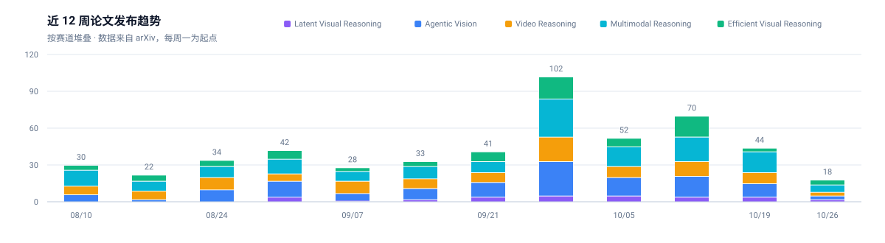
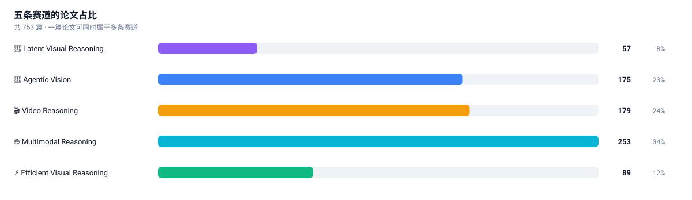

# Awesome Visual Reasoning [](https://awesome.re)

<picture>
  <source media="(prefers-color-scheme: dark)" srcset="assets/banner-dark.svg">
  
</picture>

**自动跟踪「模型怎么在视觉上思考」的开源情报站。**

聚焦四条主线——**潜在视觉推理（Latent Visual Reasoning）**、**智能体视觉（Agentic Vision）**、
**视频推理（Video Reasoning）**、**多模态推理底座（Multimodal Reasoning）**——
外加一条横切的**视觉推理效率**。每天由 GitHub Actions 从 arXiv 与 GitHub 抓取、打分、去重、归类，
自动更新论文清单、项目增速榜和周报。

[](https://github.com/isLinXu/awesome-visual-reasoning/commits)
[](https://github.com/isLinXu/awesome-visual-reasoning/actions/workflows/track.yml)
[](LICENSE)
[](scripts)
[](CONTRIBUTING.md)
[](.github/workflows/track.yml)

| 收录论文 | 近 7 天新论文 | 跟踪仓库 | 累计 star |
| --: | --: | --: | --: |
| <!--STATS:papers-->753<!--/STATS:papers--> 篇 | <!--STATS:papers_new-->+37<!--/STATS:papers_new--> | <!--STATS:repos-->113<!--/STATS:repos--> 个 | <!--STATS:stars-->311,864<!--/STATS:stars--> |

> 最后自动更新：<!--STATS:updated-->2026-10-26<!--/STATS:updated-->

---

## 为什么做这个

多模态推理的进展速度已经超过任何人手动维护清单的能力。更麻烦的是，**同一个问题被四条不同的技术路线分别回答**：

- 模型不看图也能答对 → **latent 派**说：别用语言想了，直接在隐空间里想；
- 模型看不到细节 → **agentic 派**说：让它自己放大、裁切、检索；
- 模型记不住长视频 → **video 派**说：把时间压进记忆预算；
- 全都太贵 → **效率派**说：先砍 token 再谈能力。

这些工作散落在 arXiv 的 cs.CV / cs.CL / cs.AI 里，用同一个关键词搜不全，用不同关键词搜又会重复。
本仓库用一套**可配置的分类法 + 打分器**把它们归到同一条赛道上，让你能横向比较"同一问题、不同解法"。

## 赛道地图

```
                       ┌──────────────────────────────────────────┐
                       │        多模态推理底座 (Multimodal)        │
                       │   RLVR / 过程奖励 / 测试时扩展 / omni     │
                       └───────────────┬──────────────────────────┘
                                       │ 提供训练与评测基础设施
        ┌──────────────────────────────┼──────────────────────────────┐
        │                              │                              │
┌───────▼────────┐          ┌──────────▼─────────┐          ┌─────────▼────────┐
│  🧠 潜在视觉推理 │◀────────▶│  🤖 智能体视觉      │◀────────▶│  🎬 视频推理      │
│  在隐空间里想    │  内隐↔外显 │  主动看、调工具     │  时间轴展开│  在时间里推理     │
└───────┬────────┘          └──────────┬─────────┘          └─────────┬────────┘
        │                              │                              │
        └──────────────┬───────────────┴──────────────┬───────────────┘
                       │        共同的瓶颈：token 预算   │
                ┌──────▼──────────────────────────────▼──────┐
                │        ⚡ 视觉推理效率 (横切赛道)             │
                │   token 剪枝 / 动态分辨率 / thinking budget  │
                └────────────────────────────────────────────┘
```

| 赛道 | 一句话 | 文档 | 必读 | 文档内条目 |
| :-- | :-- | :-- | --: | --: |
| 🧠 **Latent Visual Reasoning** | 不写出来，直接在隐空间里想 | [latent-visual-reasoning.md](docs/latent-visual-reasoning.md) | 5 | <!--STATS:cat_latent-visual-reasoning-->57<!--/STATS:cat_latent-visual-reasoning--> 篇 |
| 🤖 **Agentic Vision** | 视觉从"看一眼"变成"动起来看" | [agentic-vision.md](docs/agentic-vision.md) | 6 | <!--STATS:cat_agentic-vision-->175<!--/STATS:cat_agentic-vision--> 篇 |
| 🎬 **Video Reasoning** | 从视频问答升级为在时间里推理 | [video-reasoning.md](docs/video-reasoning.md) | 6 | <!--STATS:cat_video-reasoning-->179<!--/STATS:cat_video-reasoning--> 篇 |
| 🌐 **Multimodal Reasoning** | 上面三条赛道共用的地基 | [multimodal-reasoning.md](docs/multimodal-reasoning.md) | 5 | <!--STATS:cat_multimodal-reasoning-->200<!--/STATS:cat_multimodal-reasoning--> 篇 |
| ⚡ **Efficient Visual Reasoning** | 想得起，也想得便宜 | [efficient-visual-reasoning.md](docs/efficient-visual-reasoning.md) | 3 | <!--STATS:cat_efficient-visual-reasoning-->89<!--/STATS:cat_efficient-visual-reasoning--> 篇 |

其他入口：**[🚀 项目雷达](docs/projects.md)**（按 7 日 star 增速排）· **[📬 自动周报](docs/digest.md)**

## 现在什么情况

两张图都由 `scripts/render_charts.py` 从 `data/*.json` 直接渲染，随每天的抓取自动重画——
不是人工贴的截图，所以数字永远和表格对得上。

<picture>
  <source media="(prefers-color-scheme: dark)" srcset="assets/trend-dark.svg">
  
</picture>

<picture>
  <source media="(prefers-color-scheme: dark)" srcset="assets/distribution-dark.svg">
  
</picture>

看图能读出三件事：

- **Multimodal 是地基，也是最拥挤的地方**（约三分之一）。它门槛最低、复用最广，所以论文量最大。
- **Agentic 与 Video 体量接近**，但增长节奏不同：Agentic 的爆发跟 GUI agent 产品化同步，Video 更受长上下文与 token 预算限制。
- **Latent 论文最少，却是引用密度最高的一条**。它的价值不在数量，在于提出"别用语言想了"这个反直觉的路线。

## 自动化是怎么跑的

```
        ┌──────────────────────────────────────────────────────────────┐
        │  GitHub Actions · 每天 01:30 UTC（也可手动触发）               │
        └───────────────────────────┬──────────────────────────────────┘
                                    ▼
   ┌────────────────┐   ┌────────────────────┐   ┌────────────────────┐
   │ fetch_arxiv.py │   │  track_github.py   │   │ update_metadata.py │
   │  arXiv 检索     │   │  仓库搜索 + star    │   │  统计 / 徽章 / 周报 │
   │  HF Daily 热度  │   │  快照 + 增速计算    │   │  跨文档计数         │
   └───────┬────────┘   └─────────┬──────────┘   └─────────┬──────────┘
           │  打分·归类·去重        │  历史累积              │
           ▼                      ▼                       ▼
   docs/*.md 标记表格        data/repos.json          README 数字
   data/papers.json         (每日 star 快照)          docs/digest.md
           │                      │
           └──────────┬───────────┘
                      ▼
          ┌───────────────────────┐
          │   render_charts.py    │  ← 把 JSON 直接画成 SVG
          │   横幅 / 趋势 / 占比 /  │     不截图、不存位图
          │   各赛道 sparkline     │     浅色深色各一套
          └───────────┬───────────┘
                      ▼
                 assets/*.svg
                      │
                      ▼
        有变更才 commit（幂等，重跑无副作用）
```

六个设计取舍，直接决定了它能不能长期跑下去：

1. **标记块写入，而不是字符串定位。** 表格被 `<!-- table:start xxx -->` 包住，脚本只动块内，正文随便你改。
2. **状态外置到 `data/*.json`。** 去重靠历史库而不是靠"文档里有没有这一行"，所以表格被截断也不会重复插入。
3. **按 arXiv ID 校验必读清单。** ID 失效或指向别的论文会被自动剔除，文档里永远不会留死链或张冠李戴。
4. **打分而非关键词硬匹配。** 强/中/弱三档关键词 × 标题/摘要两个位置加权，阈值可调，误收和漏收都能靠配置修。

再加两条专门治"自动化会翻车的地方"：

5. **增速算不出来时用日均折算，而不是退回总 star。** 快照是逐日累积的，建库首日只有一天记录，
   真实 7 日增量必然为空。此时若按总 star 排，榜单会退化成"老牌大项目榜"——恰恰违背了做增速榜的初衷。
   所以用 `总 star ÷ 存活天数 × 7` 折算顶上，表格里标 `≈` 明示是估算，满 7 天后自动切回实测值。
6. **自动化负责召回，人工负责精确剔除。** `computer-use` 这个词在 2026 年已经泛化到任何桌面 AI 工具，
   靠关键词堵不干净。所以留了一份 `github_blocklist`，只放确定离题的仓库——
   自动部分追求"不漏"，人工部分保证"不误"，两边各管一段。

## 快速开始

```bash
git clone https://github.com/isLinXu/awesome-visual-reasoning.git
cd awesome-visual-reasoning
pip install -r requirements.txt

# 1) 校验并填充各赛道的「奠基与必读」
python scripts/seed_classics.py

# 2) 抓论文（首次建库建议回填半年）
python scripts/fetch_arxiv.py --days 180
#    日常增量：python scripts/fetch_arxiv.py

# 3) 跟踪仓库（建议带 token，未认证搜索限流 10 次/分钟）
GITHUB_TOKEN=ghp_xxx python scripts/track_github.py

# 4) 刷新统计、徽章与周报
python scripts/update_metadata.py

# 5) 重画图表（README 横幅 / 趋势 / 占比 / 各赛道 sparkline）
python scripts/render_charts.py

# 6) 自检（表格列数 / 链接 / 图片引用 / 标记完整性）
python scripts/check_md.py
```

常用参数：

```bash
python scripts/fetch_arxiv.py --dry-run              # 只看会写什么
python scripts/fetch_arxiv.py --category video-reasoning --days 30
python scripts/fetch_arxiv.py --sources arxiv        # 只用 arXiv，跳过 HF
python scripts/track_github.py --top 40 --skip-search
python scripts/render_charts.py --weeks 16           # 趋势图改成 16 周
```

## 想加一条赛道 / 换个方向？

全部逻辑由 [`config/taxonomy.yml`](config/taxonomy.yml) 驱动，改配置不用改代码：

```yaml
categories:
  - id: my-new-track
    name: "My Track"
    emoji: "🧪"
    doc: "docs/my-new-track.md"      # 建一个带 marker 表格的文档
    arxiv_queries: ['all:"your query"']
    github_queries: ["your repo query"]
    keywords:
      strong: ["exact term"]          # 命中标题 +6 分
      medium: ["related term"]        # +3 分
      weak:   ["loose term"]          # +1 分
    classics:                         # 会按 arXiv ID 校验
      - {id: "2412.06769", expect: "coconut", note: "为什么必读"}
```

## 贡献

欢迎三类贡献：**补经典论文**（带 arXiv ID）、**加仓库到种子列表**、**修分类关键词**。
详见 [CONTRIBUTING.md](CONTRIBUTING.md)，或直接开 Issue 说"这篇该收进来"。

## 免责声明

论文标题、作者、摘要来自 arXiv API，仓库 star 数来自 GitHub API，均保留原始来源链接。
自动归类基于关键词打分，**不保证每条都归到最优赛道**——它更擅长"不漏"，而不是"完美分类"。
分数仅代表关键词相关度，不代表论文质量。

## License

[MIT](LICENSE) · 内容版权归各论文与项目作者所有。
