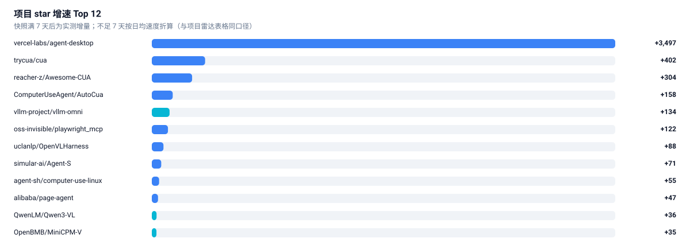

# 🚀 项目雷达 · GitHub Tracker

> 每日快照 star 数，按 **7 日增速** 排序。增速比总量更能反映"现在大家在做什么"。
> 数据来自 `data/repos.json`（含每个仓库的 star 历史），由 `scripts/track_github.py` 维护。

[← 返回总览](../README.md) · [自动周报](digest.md)

---

## 榜单口径

| 项目 | 说明 |
| :-- | :-- |
| 入选 | 配置中的种子仓库 + 按赛道关键词搜索命中（`stars ≥ 阈值`、近半年有 push、非归档、不在黑名单） |
| 排序 | 7 日 star 增量 → 30 日增量 → 总 star；**快照不足 7 天时用日均增速折算兜底** |
| `≈+N` | **估算值**：按 `总 star ÷ 仓库存活天数 × 7` 折算，不是实测增量，仅供建库首日排序参考 |
| `—` | 该窗口无法计算，也没有估算依据（如缺少创建时间） |
| `🆕` | 仓库创建于近 120 天内 |

> 为什么不用总 star 排？因为总 star 是**存量**，会把多年前的老项目顶在上面；
> 增速是**流量**，才看得出赛道当前的注意力在哪。
>
> 为什么首日要用估算兜底？因为本仓库的快照是逐日累积的，刚建库时所有仓库都只有一天记录，
> 真实 7 日增量算不出来。若此时直接按总 star 排，榜单会退化成"老牌大项目榜"，
> 刚爆发的项目永远上不来——这恰好违背了做增速榜的初衷。所以用日均速度折算成 7 日估计值顶上，
> **满 7 天后自动切换为真实增量**，估算值随之消失。

## 当前榜单

先看增速，再看明细——条形长度是 7 日 star 增量，颜色是所属赛道：

<picture>
  <source media="(prefers-color-scheme: dark)" srcset="../assets/ranking-dark.svg">
  
</picture>

完整 60 条含语言、赛道、30 日增量的明细表：

<!-- table:start repos -->
| 排名 | 项目 | 一句话 | ⭐ | 7 日 Δ | 30 日 Δ | 语言 | 赛道 |
| --: | :-- | :-- | --: | --: | --: | :-- | :-- |
| 1 | [**vercel-labs/agent-desktop**](https://github.com/vercel-labs/agent-desktop) | Computer use CLI for AI agents | ⭐ 23,910 | +4,789 | — | Rust | `agentic-vision` |
| 2 | [**trycua/cua**](https://github.com/trycua/cua) | Scale computer-use 2.0 with open-source drivers, cross-OS sandboxes… | ⭐ 32,360 | +392 | — | Rust | `agentic-vision` |
| 3 | [**reacher-z/Awesome-CUA**](https://github.com/reacher-z/Awesome-CUA) 🆕 | Open, source-backed catalog of computer-use agents: reviewed papers… | ⭐ 911 | +339 | — | Python | `agentic-vision` |
| 4 | [**vllm-project/vllm-omni**](https://github.com/vllm-project/vllm-omni) | A framework for efficient model inference with omni-modality models | ⭐ 7,764 | +148 | — | Python | `multimodal-reasoning` |
| 5 | [**oss-invisible/playwright_mcp**](https://github.com/oss-invisible/playwright_mcp) 🆕 | invisible playwright mcp: Playwright MCP server undetected by anti-bots and ca… | ⭐ 865 | ≈+129 | — | Python | `agentic-vision` |
| 6 | [**ComputerUseAgent/AutoCua**](https://github.com/ComputerUseAgent/AutoCua) 🆕 | Automate with computer use agent (ComputerUse / CUA) for macOS, Windows… | ⭐ 1,224 | +120 | — | Rust | `agentic-vision` |
| 7 | [**uclanlp/OpenVLHarness**](https://github.com/uclanlp/OpenVLHarness) 🆕 | Official Code for OpenVLHarness: Real-World Visual Agentic Tool‑Use with Multi… | ⭐ 507 | +90 | — | Python | `agentic-vision` |
| 8 | [**simular-ai/Agent-S**](https://github.com/simular-ai/Agent-S) | Agent S: the state-of-the-art open source computer use agents | ⭐ 12,973 | +70 | — | Python | `agentic-vision` |
| 9 | [**OpenBMB/MiniCPM-V**](https://github.com/OpenBMB/MiniCPM-V) | See, hear, and interact on your local devices. | ⭐ 27,151 | +64 | — | Python | `multimodal-reasoning` |
| 10 | [**agent-sh/computer-use-linux**](https://github.com/agent-sh/computer-use-linux) | Native Linux desktop control for AI agents (MCP, Pi… | ⭐ 885 | +57 | — | Rust | `agentic-vision` |
| 11 | [**alibaba/page-agent**](https://github.com/alibaba/page-agent) | JavaScript in-page GUI agent. Control web interfaces with natural language. | ⭐ 29,690 | +43 | — | TypeScript | `agentic-vision` |
| 12 | [**HKUDS/VideoAgent**](https://github.com/HKUDS/VideoAgent) | [EMNLP2026] "VideoAgent: All-in-One Agentic Framework for Video Understanding… | ⭐ 2,049 | +39 | — | Python | `video-reasoning` |
| 13 | [**QwenLM/Qwen3-VL**](https://github.com/QwenLM/Qwen3-VL) | Qwen3-VL is the multimodal large language model series developed by Qwen team… | ⭐ 20,211 | +35 | — | Jupyter Notebook | `multimodal-reasoning` |
| 14 | [**Tencent/UI-Mate**](https://github.com/Tencent/UI-Mate) 🆕 | Advancing Foundation GUI Agents with In-Context Demonstrations | ⭐ 136 | +19 | — | JavaScript | `agentic-vision` |
| 15 | [**AMAP-ML/LongHorizon-Harness**](https://github.com/AMAP-ML/LongHorizon-Harness) 🆕 | The long-horizon computer-use harness. Run AI agents across desktop apps and t… | ⭐ 1,873 | +16 | — | Python | `agentic-vision` |
| 16 | [**Hacker-Valley-Media/Interceptor**](https://github.com/Hacker-Valley-Media/Interceptor) | Browser automation and computer use for AI agents… | ⭐ 627 | +16 | — | TypeScript | `agentic-vision` |
| 17 | [**bytedance/UI-TARS-desktop**](https://github.com/bytedance/UI-TARS-desktop) | The Open-Source Multimodal AI Agent Stack: Connecting Cutting-Edge AI Models a… | ⭐ 39,585 | +15 | — | TypeScript | `agentic-vision` |
| 18 | [**OpenAdaptAI/OpenAdapt**](https://github.com/OpenAdaptAI/OpenAdapt) | For EHRs, payer portals, and any app your team clicks through… | ⭐ 1,882 | +14 | — | Python | `agentic-vision` |
| 19 | [**MCG-NJU/VideoJev**](https://github.com/MCG-NJU/VideoJev) 🆕 | VideoJev: System One Model for Video Understanding and Interaction | ⭐ 310 | +13 | — | Python | `video-reasoning` |
| 20 | [**microsoft/OmniParser**](https://github.com/microsoft/OmniParser) | A simple screen parsing tool towards pure vision based GUI agent | ⭐ 25,623 | +12 | — | Jupyter Notebook | `agentic-vision` |
| 21 | [**Purewhiter/mobilegym**](https://github.com/Purewhiter/mobilegym) | [EMNLP 2026] MobileGym: A Verifiable and Highly Parallel Simulation Platform f… | ⭐ 866 | +12 | — | Python | `agentic-vision` |
| 22 | [**OpenMOSS/MOSS-VL**](https://github.com/OpenMOSS/MOSS-VL) | An open-weight 11B model series for long-form and real-time video understandin… | ⭐ 833 | +11 | — | C++ | `video-reasoning` |
| 23 | [**skalesapp/skales**](https://github.com/skalesapp/skales) | Personal AI agent harness for macOS, Windows, Linux, Android & iOS… | ⭐ 2,239 | +9 | — | — | `agentic-vision` |
| 24 | [**xlang-ai/OSWorld-V2**](https://github.com/xlang-ai/OSWorld-V2) | OSWorld 2.0: Benchmarking Computer Use Agents on Long-Horizon Real-World Tasks | ⭐ 421 | +9 | — | Python | `agentic-vision` |
| 25 | [**bytedance/UI-TARS**](https://github.com/bytedance/UI-TARS) | Pioneering Automated GUI Interaction with Native Agents | ⭐ 11,692 | +8 | — | Python | `agentic-vision` |
| 26 | [**X-PLUG/MobileAgent**](https://github.com/X-PLUG/MobileAgent) | Mobile-Agent: The Powerful GUI Agent Family | ⭐ 9,379 | +8 | — | Python | `agentic-vision` |
| 27 | [**Tongyi-MAI/OpenGCUA**](https://github.com/Tongyi-MAI/OpenGCUA) 🆕 | An open-source stack for generalist computer-use agents… | ⭐ 602 | +8 | — | HTML | `agentic-vision` |
| 28 | [**microsoft/fara**](https://github.com/microsoft/fara) | Fara1.5 – A family of frontier computer use agent models | ⭐ 6,255 | +6 | — | Python | `agentic-vision` |
| 29 | [**alchaincyf/huashu-mac-use**](https://github.com/alchaincyf/huashu-mac-use) 🆕 | 让任何 agent 操控 Mac 上没有 API 的原生 app，读后台、写不打扰、每步留取证 · Agent Skill for macOS comput… | ⭐ 344 | +6 | — | Swift | `agentic-vision` |
| 30 | [**MadeAgents/mobile-use**](https://github.com/MadeAgents/mobile-use) | MobileUse: an open-source mobile GUI agent for Android phone automation… | ⭐ 267 | +6 | — | Python | `agentic-vision` |
| 31 | [**deepseek-ai/DeepSeek-VL2**](https://github.com/deepseek-ai/DeepSeek-VL2) | DeepSeek-VL2: Mixture-of-Experts Vision-Language Models for Advanced Multimoda… | ⭐ 5,405 | +5 | — | Python | `multimodal-reasoning` |
| 32 | [**sotayang/Awesome-Streaming-Video-Understanding**](https://github.com/sotayang/Awesome-Streaming-Video-Understanding) | 🔥🔥🔥 [Awesome] Latest Papers, Codes & Datasets on Streaming / Online Video Unde… | ⭐ 498 | +5 | — | — | `video-reasoning` |
| 33 | [**xlang-ai/OSWorld**](https://github.com/xlang-ai/OSWorld) | [NeurIPS 2024] OSWorld: Benchmarking Multimodal Agents for Open-Ended Tasks in… | ⭐ 3,260 | +4 | — | Python | `agentic-vision` |
| 34 | [**e2b-dev/open-computer-use**](https://github.com/e2b-dev/open-computer-use) | AI computer use powered by open source LLMs and E2B Desktop Sandbox | ⭐ 2,410 | +4 | — | Python | `agentic-vision` |
| 35 | [**Core-Mate/OpenGUI**](https://github.com/Core-Mate/OpenGUI) | OpenGUI is an Android GUI agent framework for phone-use AI that can see… | ⭐ 1,811 | +4 | — | HTML | `agentic-vision` |
| 36 | [**zai-org/CogAgent**](https://github.com/zai-org/CogAgent) | An open-sourced end-to-end VLM-based GUI Agent | ⭐ 1,202 | +4 | — | Python | `agentic-vision` |
| 37 | [**Livioni/OmniVGGT-official**](https://github.com/Livioni/OmniVGGT-official) | [CVPR 2026 Hightlight] OmniVGGT: Omni-Modality Driven Visual Geometry Grounded… | ⭐ 385 | +4 | — | Python | `multimodal-reasoning` |
| 38 | [**wgcyeo/WorldMM**](https://github.com/wgcyeo/WorldMM) | [CVPR 2026 Highlight] WorldMM: Dynamic Multimodal Memory Agent for Long Video… | ⭐ 137 | +4 | — | Python | `video-reasoning` |
| 39 | [**HarryHsing/OmniAgent**](https://github.com/HarryHsing/OmniAgent) | OmniAgent (ICML 2026): the first native omni-modal agent for active video perc… | ⭐ 90 | +4 | — | Python | `multimodal-reasoning` |
| 40 | [**zai-org/GLM-V**](https://github.com/zai-org/GLM-V) | GLM-4.6V/4.5V/4.1V-Thinking: Towards Versatile Multimodal Reasoning with Scala… | ⭐ 2,406 | +3 | — | Python | `multimodal-reasoning` |
| 41 | [**bytedance/Lance**](https://github.com/bytedance/Lance) | A 3B-active-parameter native unified multimodal model for image and video unde… | ⭐ 1,368 | +3 | — | Python | `video-reasoning` |
| 42 | [**inclusionAI/UI-Venus**](https://github.com/inclusionAI/UI-Venus) | UI-Venus is a general-purpose foundation GUI agent for mobile apps… | ⭐ 1,080 | +3 | — | HTML | `agentic-vision` |
| 43 | [**OSU-NLP-Group/GUI-Agents-Paper-List**](https://github.com/OSU-NLP-Group/GUI-Agents-Paper-List) | Awesome GUI Agent Paper List | ⭐ 929 | +3 | — | TypeScript | `agentic-vision` |
| 44 | [**xlang-ai/OpenCUA**](https://github.com/xlang-ai/OpenCUA) | [NeurIPS 2025 Spotlight] OpenCUA: Open Foundations for Computer-Use Agents | ⭐ 877 | +3 | — | Python | `agentic-vision` |
| 45 | [**redai-studio/Relax**](https://github.com/redai-studio/Relax) | An Asynchronous Reinforcement Learning Engine for Omni-Modal Post-Training at… | ⭐ 676 | +3 | — | Python | `multimodal-reasoning` |
| 46 | [**ZJU-REAL/Awesome-GUI-Agents**](https://github.com/ZJU-REAL/Awesome-GUI-Agents) | A curated collection of resources, tools… | ⭐ 469 | +3 | — | — | `agentic-vision` |
| 47 | [**chekusu/yomado**](https://github.com/chekusu/yomado) 🆕 | Native macOS virtual displays for visual agents… | ⭐ 217 | +3 | — | Objective-C | `agentic-vision` |
| 48 | [**teee000/LiLa-WAM**](https://github.com/teee000/LiLa-WAM) 🆕 | LiLa-WAM: Lightweight Latent Reasoning World-Action Model for Robotic Manipula… | ⭐ 166 | +3 | — | Python | `latent-visual-reasoning` |
| 49 | [**nv-tlabs/PixelUMM**](https://github.com/nv-tlabs/PixelUMM) 🆕 | Encoder-Free Unified Image and Video Understanding and Generation | ⭐ 419 | +2 | — | Python | `video-reasoning` |
| 50 | [**opendilab/LightRFT**](https://github.com/opendilab/LightRFT) | LightRFT: Light, Efficient, Omni-modal & Reward-model Driven Reinforcement Fin… | ⭐ 381 | +2 | — | Python | `multimodal-reasoning` |
| 51 | [**yoloytang/BVB**](https://github.com/yoloytang/BVB) | BVB: Benchmarking Agentic Video Understanding via Programmatic Reconstruction… | ⭐ 124 | +2 | — | Python | `video-reasoning` |
| 52 | [**UniPat-AI/SaaS-Bench**](https://github.com/UniPat-AI/SaaS-Bench) | Official repository for SaaS-Bench: realistic… | ⭐ 108 | +2 | — | Python | `agentic-vision` |
| 53 | [**yuruotong1/autoMate**](https://github.com/yuruotong1/autoMate) | Like Manus, Computer Use Agent(CUA) and Omniparser… | ⭐ 4,009 | +1 | — | Python | `agentic-vision` |
| 54 | [**NVlabs/VILA**](https://github.com/NVlabs/VILA) | VILA is a family of state-of-the-art vision language models (VLMs) for diverse… | ⭐ 3,873 | +1 | — | Python | `multimodal-reasoning` |
| 55 | [**TurixAI/TuriX-CUA**](https://github.com/TurixAI/TuriX-CUA) | This is the official website for TuriX Computer-use-Agent | ⭐ 3,178 | +1 | — | Python | `agentic-vision` |
| 56 | [**Tongyi-MAI/MAI-UI**](https://github.com/Tongyi-MAI/MAI-UI) | Qwen-UI-Agent: Towards Next-Generation Real-World Centric Foundation GUI Agent | ⭐ 2,429 | +1 | — | Jupyter Notebook | `agentic-vision` |
| 57 | [**IPADS-SAI/MobiAgent**](https://github.com/IPADS-SAI/MobiAgent) | The Intelligent GUI Agent for Mobile Phones | ⭐ 1,935 | +1 | — | Python | `agentic-vision` |
| 58 | [**showlab/ShowUI**](https://github.com/showlab/ShowUI) | [CVPR 2025] Open-source, End-to-end, Vision-Language-Action model for GUI Agen… | ⭐ 1,930 | +1 | — | Python | `agentic-vision` |
| 59 | [**zhaochen0110/Awesome_Think_With_Images**](https://github.com/zhaochen0110/Awesome_Think_With_Images) | Resources and paper list for "Thinking with Images for LVLMs"… | ⭐ 1,520 | +1 | — | — | `latent-visual-reasoning` |
| 60 | [**mbzuai-oryx/Video-ChatGPT**](https://github.com/mbzuai-oryx/Video-ChatGPT) | [ACL 2024 🔥] Video-ChatGPT is a video conversation model capable of generating… | ⭐ 1,517 | +1 | — | Python | `video-reasoning` |
<!-- table:end repos -->

## 怎么读这张榜

- **`agentic-vision` 扎堆**：说明工程侧正在从"模型能力"转向"可执行的 agent 产品"，GUI/computer-use 是最卷的落地场景。
- **`multimodal-reasoning` 长期霸榜**：底座模型的每一次发布都会带来一波 star 迁移，看增量比看总量更有信息量。
- **`latent-visual-reasoning` 仓库偏少**：这是典型的研究早期特征——论文多、开源少、复现成本高。想找机会的话，这里是空档。
- **增速突然拉起的仓库**，通常对应一次模型发布或一篇高传播度论文，值得点进去看 commit 时间线。

## 想看更细的？

- 每个仓库的完整 star 历史：`data/repos.json` → `repos.<full_name>.history`
- 赛道分布与总量：`data/stats.json`
- 想加仓库：改 `config/taxonomy.yml` 的 `github_seed` 或 `github_queries`，或直接提 Issue。

---

[← 返回总览](../README.md) · [自动周报](digest.md)
